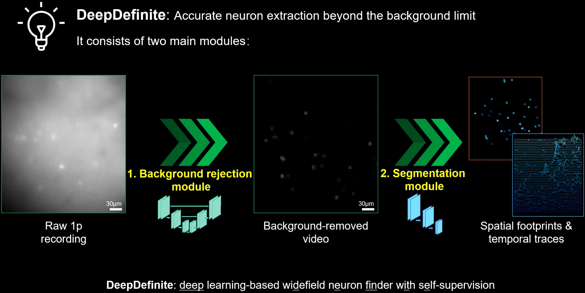

# **DeepDefinite**

DeepDefinite is an algorithm for accurate neuron extraction on single-photon (1p) videos beyond the inherent background limit of 1p microscopy.

DeepDefinite is self-supervised but performs well. Welcome to our webapp: http://region-31.seetacloud.com:36894/.

The MultiModel NeuralImaging Benchmark (MMNIB) dataset can be downloaded [here](https://drive.google.com/drive/folders/1095PivRqH5rDVSg9dDG2ixeqUUNveGmw?usp=drive_link).


- [**DeepDefinite**](#deepdefinite)
  - [**Getting Started**](#getting-started)
    - [Prerequisites](#prerequisites)
    - [Install](#install)
    - [Prepare the dataset](#prepare-the-dataset)
    - [Prepare the pretrained weights](#prepare-the-pretrained-weights)
  - [**Remove the background**](#remove-the-background)
    - [Training](#training)
    - [Background removal](#background-removal)
  - [**Segmentation**](#segmentation)
    - [Training](#training-1)
    - [Segmentation](#segmentation-1)

## Overview

### Overall pipeline



DeepDefinite consists of two main modules:

- 1. Background rejection module
- 2. Segmentation module


The input of DeepDefinite is a set of raw 1p recordings sharing similar data modality.

The background rejection module will output background-removed videos, and spatial footprints and temporal traces will be provided by segmentation module.


### Important Parameters

#### **Parameters characterizing the calcium imaging video**

- **Neuron size**: expected half size of neurons. To measure the neuron size, one can use Fiji to isolate a single neuron from input 1p calcium movie, and plot its intensity profile to determine the optimal value. 
- **Size of ring-shaped filter**: By default, the diameter of the ring-shaped filter is configured to be 1.5 times the diameter of the neuron. The thickness of this annular filter is set at two pixels with a uniform weight.

- **Acquisition frame rate**: the acquisition frame rate (in Hz) of the calcium movie.

- **$\tau_{on}$ and $\tau_{off}$**: calcium response on and off parameters, which depends on the types of calcium indicators. In the majority of datasets, we configured $\tau_{on}$ to be exceptionally minimal to ensure a sharp ascent in the calcium response, whereas $\tau_{off}$ was contingent upon the specific calcium indicators and corresponding genetic lines.


#### **Parameters characterizing the network training**

- **Threshold post the data-cleanse network**: We remove remaining residuals after the background rejection module based on the threshold post the data-cleanse network. The threshold constituted a hyperparameter, typically configured at 0.4 of the maximum value in the processed input movie, following the exclusion of the top 1st percentiles of bright pixels. Subsequently, it is processed by a sparsification network.
- **Initial learning rate**: The learning rate dictates the magnitude of each iterative step throughout the network training process. In the implementation of DeepDefinite, this parameter undergoes a decay factor of 0.5 at 10-epoch intervals, commencing from its initial value. Elevated initial learning rates generally accelerate model convergence but may concurrently introduce instability into the training regimen. As such, the initial learning rate is empirically established at 1e-4.

- **Patch size**: The dimensionality of the patch size influences the resultant image morphology with implications for both the computational efficiency and efficacy of the trained neural network models. In the interest of expediting the training regimen, we generally opt for a modest patch size of 128×128×128 pixels, which also serves as the default configuration in our Python implementations.

- **Batch size**: The batch size which is defined as the quantity of samples employed for each training epoch exerts impacts on both the speed of model convergence and the generalizability of the resultant neural network. Extremes in batch size—either excessively large or diminutive—can precipitate challenges, such as memory overload or erratic convergence patterns. Within the experimental framework of this study, we judiciously selected a moderate batch size of 32, applicable to both the data cleanse and sparsification networks.

- **Total epoch**: The total number of epochs delineates the cumulative iterations throughout the training process. Customarily, we establish a total of 30 epochs for both the data cleanse and sparsification networks, a quantity demonstrated to facilitate network convergence in the majority of experimental scenarios.

- **Loss weights**: We utilized mixed L1 loss (weight 1) and L2 loss (weight 1) for data cleanse network, and mixed L1 loss (weight 1) and sparse loss (weight 10) for the sparsification network.
- **Threshold of spatial clustering**. We employed spatial hierarchical clustering to cluster neuron segments situated in proximate locations. The default spatial clustering threshold is configured to the dimensions of a single neuron, ensuring that a cluster does not significantly exceed the size of an individual neuron.

- **Threshold of temporal clustering**. We employed temporal hierarchical clustering to cluster neuron segments subject to the spatial clustering according to the pairwise correlations of the temporal traces. The default temporal correlation threshold is set to be 0.7.


## **Getting Started**

### Dataset
The MultiModel NeuralImaging Benchmark (MMNIB) dataset can be downloaded at https://drive.google.com/drive/folders/1095PivRqH5rDVSg9dDG2ixeqUUNveGmw?usp=drive_link


### Use in website

The website is the easiest and simplest way to use DeepDenfinite. Welcome to our webapp: http://region-31.seetacloud.com:36894/


### Use as a Fiji plugin

The deepdefinite pipeline can also be used as a Fiji Imagej plugin, which is provided here: https://drive.google.com/drive/folders/1RCdgfLWDkRIgK-xEiY2Nl4R29YXpqVAB?usp=drive_link


### Use in python

#### Prerequisites

- Python 3
- NVIDIA GPU + CUDA + CuDNN

Note: Perhaps users can run the codes we provided using only the CPU, but using GPU is highly recommended.

#### Install

- Clone the repository:

```bash
git clone https://github.com/jerryniu520126/DeepDefinite.git
cd DeepDefinite
```

- Dependencies: We recommend running this repository using [Anaconda](https://docs.anaconda.com/anaconda/install/). The codes are tested under `PyTorch 1.9.1` and `CUDA 11.3`. Please install them under the instructions [here](https://pytorch.org/get-started/previous-versions/#v191). All the required packages are listed in `requirements.txt`.

#### Prepare the dataset

We provided our dataset [here](https://drive.google.com/drive/folders/1095PivRqH5rDVSg9dDG2ixeqUUNveGmw?usp=drive_link). Prepare the raw 1p recordings and put them into the folder `/datasets/dataset_orig`. Of course, you are welcome to put your dataset in it. This github demo assumes the directory structure should be as follows.

```
datasets
└── dataset_orig
    ├── 1.tiff
    ├── 2.tiff
    └── ...
```

If you just want to have a simple try and skip the training process, we have prepared a set of pretrained parameters for dataset `5_macro_5x` (a part of MMNIB dataset) in this github repo. Please download the 1p videos of `5_macro_5x`  [here](https://drive.google.com/drive/folders/1095PivRqH5rDVSg9dDG2ixeqUUNveGmw?usp=drive_link) and put them into `/datasets/dataset_orig`.


## **Remove the background**

### Training

Perhaps, the input videos are very large and thus GPU does not have enough space to store. In this case, we recommend to run

```bash
python -u ./codes/BG_Rejection/crop.py \
--patch_size '(64, 256, 256)' \
--n_patch_all 150 \
--dataset_dir ./datasets/dataset_orig \
--output_dir ./datasets/dataset_in_patches_BG
```

The command will randomly crop patches from the original videos. This step is **optional** but **highly recommended**. The following parameters can be configured in the command.

```python
def get_args_parser():
    parser = argparse.ArgumentParser('Hyper-Parameters Configuration', add_help=False)
    # Patches
    parser.add_argument('--patch_size', default='(64, 256, 256)', type=str, help='(T, H, W)')
    parser.add_argument('--n_patch_all', default=150, type=int, help='random patch number of each whole video')
    parser.add_argument('--n_patch_train', default=999999, type=int,
                        help="random patch number for training, and the rest of patches are for eval."
                             "However, we usually recommend to put all patches to `train` in the BG_Rejection stage")

    # Paths
    parser.add_argument('--dataset_dir', default='', type=str)
    parser.add_argument('--output_dir', default='', type=str)
    parser.add_argument('--seed', default=42, type=int)
    return parser
```

Then, we can train the background removal network using 

```bash
python -u ./codes/BG_Rejection/main.py \
--wo_mean \
--gsize 8 \
--dataset_dir ./datasets/dataset_orig \
--output_dir ./output/BG_output \
--gpu_ids 0,1,2,3
```

The following parameters can be configured in the command.

```python
def get_args_parser():
    parser = argparse.ArgumentParser('Hyper-Parameters Configuration', add_help=False)
    parser.add_argument('--lr', default=1e-4, type=float)
    parser.add_argument('--lr_drop', default=10, type=int, help='every 10 epochs drop lr')
    parser.add_argument('--batch_size', default=16, type=int)
    parser.add_argument('--start_epoch', default=0, type=int, metavar='N', help='start epoch')
    parser.add_argument('--epochs', default=50, type=int)
    parser.add_argument('--wo_mean', action='store_true')

    # Model parameters
    parser.add_argument('--gsize', default=8, type=int, help='neuron radius')
    parser.add_argument('--in_channels', default=1, type=int)
    parser.add_argument('--out_channels', default=1, type=int)
    parser.add_argument('--f_maps', default=32, type=int, help='initial channels of feature maps')

    # Loss coefficients
    parser.add_argument('--L1_weight', default=1.0, type=float)
    parser.add_argument('--L2_weight', default=1.0, type=float)

    # Dataset parameters
    parser.add_argument('--dataset_name', default='', type=str)
    parser.add_argument('--dataset_dir', default='', type=str)
    parser.add_argument('--output_dir', default='', type=str)
    parser.add_argument('--seed', default=42, type=int)
    parser.add_argument('--device', default='cuda')
    parser.add_argument('--resume', default='', help='resume from checkpoint')
    parser.add_argument('--eval', action='store_true', help='evaluate patch results in test set')
    parser.add_argument('--num_workers', default=8, type=int)

    # distributed training parameters
    parser.add_argument('--gpu_ids', default='0, 1, 2, 3', type=str, 
                        help='If GPU is used for training, specify the gpu ids in your machine')
    return parser
```

### Background removal

Inference (i.e. background removal on given videos) can be performed using

```bash
python -u ./codes/BG_Rejection/infer.py \
--wo_mean \
--gsize 8 \
--dataset_dir ./datasets/dataset_orig \
--output_dir ./output/BG_output/res_videos \
--ckpt_dir ./output/BG_output \
--patch_size '(128, 128, 128)' \
--stride_size '(96, 96, 96)' \
--gpu_ids 0,1,2,3
```

The following parameters can be configured in the command.

```python
def get_args_parser():
    parser = argparse.ArgumentParser('Full Image inference', add_help=False)
    parser.add_argument('--batch_size', default=1, type=int)
    parser.add_argument('--wo_mean', action='store_true')

    parser.add_argument('--patch_size', default='(128, 128, 128)', type=str)
    parser.add_argument('--stride_size', default='(96, 96, 96)', type=str)

    parser.add_argument('--gsize', default=8, type=int, help='neuron radius')
    parser.add_argument('--in_channels', default=1, type=int)
    parser.add_argument('--out_channels', default=1, type=int)
    parser.add_argument('--f_maps', default=32, type=int, help='initial channels of feature maps')

    parser.add_argument('--dataset_dir', default='', type=str)
    parser.add_argument('--output_dir', default='', type=str)
    parser.add_argument('--ckpt_dir', default='', type=str)

    parser.add_argument('--device', default='cuda')
    parser.add_argument('--gpu_ids', default='0, 1, 2, 3', type=str,
                        help='If GPU is used for inference, specify the gpu ids in your machine')
    return parser
```

### Postprocessing (optional)

If users still think the video is not clean enough after removing the background using the command above, please run

```bash
python -u ./codes/BG_Rejection/postprocessing_discard.py \
--dataset_dir ./output/BG_output/res_videos \
--threshold_max 0.5
```

This command will perform thresholding on the processed videos. 


## **Segmentation**

### Training

Similarly, the input videos may be too large to put into GPU as a whole. In this case, we recommend to run

```bash
python -u ./codes/Segmentation/crop.py \
--patch_size '(128, 128, 128)' \
--n_patch_all 150 \
--dataset_dir ./output/BG_output/res_videos/rmbg \
--output_dir ./datasets/dataset_in_patches_SEG
```

The command will randomly crop patches from the original videos. Again, this step is **optional** but **highly recommended**. The following parameters can be configured in the command.

```python
def get_args_parser():
    parser = argparse.ArgumentParser('Hyper-Parameters Configuration', add_help=False)
    # Patches
    parser.add_argument('--patch_size', default='(128, 128, 128)', type=str, help='(T, H, W)')
    parser.add_argument('--n_patch_all', default=150, type=int, help='random patch number of each whole video')
    parser.add_argument('--n_patch_train', default=100, type=int,
                        help='random patch number for training, and the rest of patches are for eval')

    # Paths
    parser.add_argument('--dataset_dir', default='', type=str)
    parser.add_argument('--output_dir', default='', type=str)
    parser.add_argument('--seed', default=42, type=int)
    return parser
```

Then, we can train the neuron segmentation network using 

```bash
python -u ./codes/Segmentation/main.py \
--wo_min \
--training_mode joint \
--gsize 8 \
--fps 15 \
--dataset_dir ./datasets/dataset_in_patches_SEG \
--output_dir ./output/SEG_output \
--gpu_ids 0,1,2,3
```

The following parameters can be configured in the command.

```python
def get_args_parser():
    parser = argparse.ArgumentParser('Hyper-Parameters Configuration', add_help=False)
    parser.add_argument('--lr', default=1e-4, type=float)
    parser.add_argument('--lr_drop', default=10, type=int)
    parser.add_argument('--batch_size', default=32, type=int)
    parser.add_argument('--start_epoch', default=0, type=int, metavar='N', help='start epoch')
    parser.add_argument('--epochs', default=100, type=int)
    parser.add_argument('--wo_min', action='store_true')
    parser.add_argument('--normalize_factor', default=1, type=int)

    # Model parameters
    parser.add_argument('--training_mode', default='joint', type=str)
    parser.add_argument('--gsize', default=5, type=int, help='neuron size')
    parser.add_argument('--fps', default=10, type=int, help='frame rate')
    parser.add_argument('--ext_rate', default=292.3, type=float, help='temporal extrusion rate')
    parser.add_argument('--in_channels', default=1, type=int)
    parser.add_argument('--out_channels', default=1, type=int)
    parser.add_argument('--f_maps', default=32, type=int, help='initial channels of feature maps')
    parser.add_argument('--n_fmaps', default=3, type=int, help='feature map levels')

    # Loss coefficients
    parser.add_argument('--L1_weight', default=1.0, type=float)
    parser.add_argument('--L2_weight', default=0.0, type=float)
    parser.add_argument('--Sparse_weight', default=10.0, type=float)

    # Dataset parameters
    parser.add_argument('--dataset_name', default='', type=str)
    parser.add_argument('--dataset_dir', default='', type=str)
    parser.add_argument('--output_dir', default='', type=str)
    parser.add_argument('--seed', default=42, type=int)
    parser.add_argument('--device', default='cuda')
    parser.add_argument('--resume', default='', help='resume from checkpoint')
    parser.add_argument('--eval', action='store_true', help='evaluate patch results in test set')
    parser.add_argument('--num_workers', default=8, type=int)

    # distributed training parameters
    parser.add_argument('--gpu_ids', default='0, 1, 2, 3', type=str,
                        help='If GPU is used for training, specify the gpu ids in your machine')
    return parser
```

### Segmentation

Inference (i.e. segmentation on given videos) can be performed using

```bash
python -u ./codes/Segmentation/infer.py \
--wo_min \
--fps 15 \
--gsize 8 \
--dataset_dir ./output/BG_output/res_videos/rmbg \
--output_dir ./output/SEG_output/res_videos \
--ckpt_dir ./output/SEG_output \
--patch_size '(128, 128, 128)' \
--stride_size '(96, 96, 96)' \
--latent_patch_size '(128, 32, 32)' \
--latent_stride_size '(96, 24, 24)' \
--gpu_ids 0,1
```

The following parameters can be configured in the command.

```python
def get_args_parser():
    parser = argparse.ArgumentParser('Full Image inference', add_help=False)
    parser.add_argument('--batch_size', default=1, type=int)
    parser.add_argument('--wo_min', action='store_true')
    parser.add_argument('--normalize_factor', default=1, type=int)

    parser.add_argument('--patch_size', default='(128, 256, 256)', type=str)
    parser.add_argument('--stride_size', default='(96, 224, 224)', type=str)
    parser.add_argument('--latent_patch_size', default='(128, 64, 64)', type=str)
    parser.add_argument('--latent_stride_size', default='(96, 56, 56)', type=str)

    parser.add_argument('--training_mode', default='joint', type=str)
    parser.add_argument('--fps', default=15, type=int, help='frame rate')
    parser.add_argument('--gsize', default=5, type=int, help='neuron size')
    parser.add_argument('--ext_rate', default=292.3, type=float, help='temporal extrusion rate')
    parser.add_argument('--in_channels', default=1, type=int)
    parser.add_argument('--out_channels', default=1, type=int)
    parser.add_argument('--f_maps', default=32, type=int, help='initial channels of feature maps')
    parser.add_argument('--n_fmaps', default=3, type=int, help='feature map levels')

    parser.add_argument('--dataset_name', default='', type=str)
    parser.add_argument('--dataset_dir', default='', type=str)
    parser.add_argument('--output_dir', default='', type=str)
    parser.add_argument('--ckpt_dir', default='', type=str)
    parser.add_argument('--ckpt_dir2', default='', type=str)

    parser.add_argument('--device', default='cuda')
    parser.add_argument('--gpu_ids', default='', type=str,
                        help='If GPU is used for inference, specify the gpu ids in your machine')
    return parser
```

### Postprocessing

Finally, get the final segmentation results by running

```bash
python -u ./codes/Segmentation/postprocessing.py \
--gsize 8 \
--rmbg_dir ./output/BG_output/res_videos/rmbg \
--latent_dir ./output/SEG_output/res_videos/latent \
--output_dir ./output/FINAL_output
```

The following parameters can be configured in the command.

```python
def get_args_parser():
    parser = argparse.ArgumentParser('Hyper-Parameters Configuration', add_help=False)

    parser.add_argument('--gsize', default=5, type=int)
    parser.add_argument('--dataset_name', default='', type=str)
    parser.add_argument('--rmbg_dir', default='', type=str)
    parser.add_argument('--latent_dir', default='', type=str)
    parser.add_argument('--output_dir', default='', type=str)
    parser.add_argument('--intensity_threshold', default=0.8, type=float)
    parser.add_argument('--temporal_threshold', default=0.3, type=float)
    return parser
```

In the end, the segmented seeds of neurons will be stored at `./output/FINAL_output/seg` and the extracted calcium signals will be saved at `./output/FINAL_output/sig`. 


## Visualize the footprints (optional)

Even though the segmented seeds of neurons are enough for extracting calcium signals, some users may need footprints of neurons. To grow the footprints of neurons from the segmented seeds, please run

```bash
python -u ./codes/Visualization/gen_footprints.py
```

The following parameters can be configured in the command.

```python
def get_args_parser():
    parser = argparse.ArgumentParser('Hyper-Parameters Configuration', add_help=False)

    # Params
    parser.add_argument('--corr_thre', default=0.5, type=float, help='Correlation coefficient threshold')
    parser.add_argument('--R', default=2, type=int, help='Radius of struct using to grow footprints. In general, the larger the `R`, the larger the `corr_thre` should be.')
    parser.add_argument('--max_iter', default=100, type=int, help='Max iterations for growing footprints')

    # Paths
    parser.add_argument('--rmbg_dir', default='./output/BG_output/res_videos/rmbg', type=str)
    parser.add_argument('--seg_dir', default='./output/FINAL_output/seg', type=str)
    parser.add_argument('--output_dir', default='./output/FINAL_output/footprints', type=str)
    return parser
```

In the end, the final footprints will also be stored in `./output/FINAL_output` by default.

